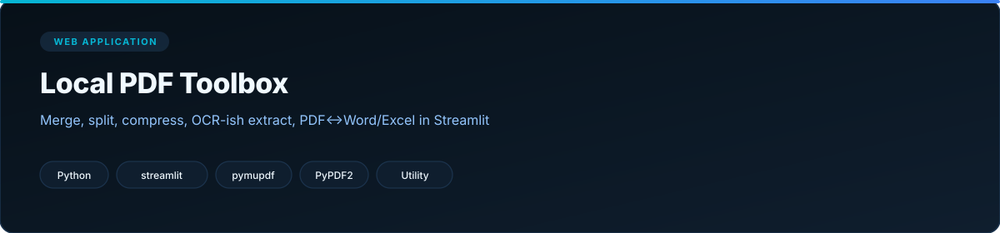
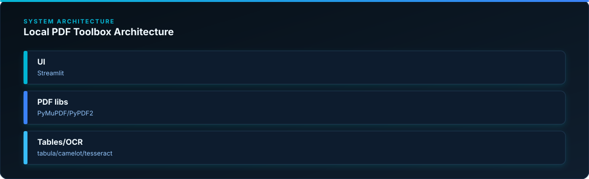
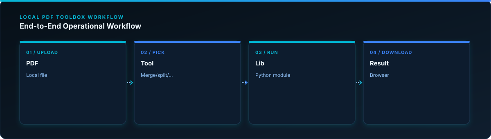
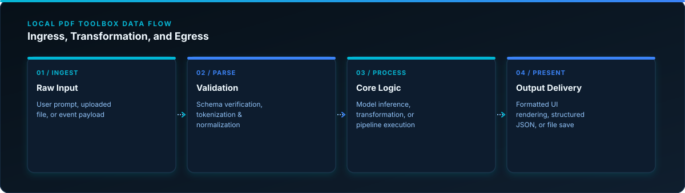
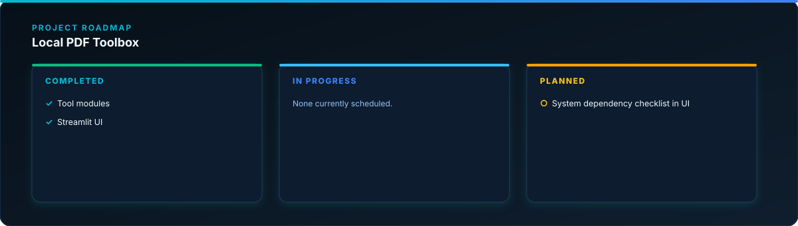

<p align="center">
  
</p>

# Local PDF Toolbox

> **Merge, split, compress, OCR-ish extract, PDF↔Word/Excel in Streamlit**

Streamlit ui.py/app.py with PyMuPDF, PyPDF2, tabula, pdfplumber, python-docx, camelot, pytesseract/pdf2image. Designed and implemented as a resilient, production-ready solution tailored for people processing pdfs on their own machine.

<p align="left">
  
  
  
  
  [](https://github.com/chyk2468/My_love_pdf)
</p>

---
## Table of Contents

- [01. Project Hero Section](#01-project-hero-section)
- [02. Table of Contents](#02-table-of-contents)
- [03. Project Overview](#03-project-overview)
- [04. The Problem](#04-the-problem)
- [05. Proposed Solution](#05-proposed-solution)
- [06. Project Objectives](#06-project-objectives)
- [07. Key Features](#07-key-features)
- [08. Application Demonstration](#08-application-demonstration)
- [09. Technology Stack](#09-technology-stack)
- [10. System Architecture](#10-system-architecture)
- [11. Detailed Workflow](#11-detailed-workflow)
- [12. Data Flow](#12-data-flow)
- [13. State & Storage Architecture](#13-database-design)
- [14. API Documentation](#14-api-documentation)
- [15. Installation and Setup](#15-installation-and-setup)
- [16. Environment Variables](#16-environment-variables)
- [17. Usage Guide](#17-usage-guide)
- [18. Project Structure](#18-project-structure)
- [19. Security and Privacy](#19-security-and-privacy)
- [20. Testing and Validation](#20-testing-and-validation)
- [21. Performance and Evaluation](#21-performance-and-evaluation)
- [22. Engineering Decisions](#22-engineering-decisions)
- [23. Challenges and Learnings](#23-challenges-and-learnings)
- [24. Limitations](#24-limitations)
- [25. Future Roadmap](#25-future-roadmap)
- [26. Contributing Guidelines](#26-contributing-guidelines)
- [27. License](#27-license)
- [28. Author Information](#28-author-information)
- [29. Acknowledgements and References](#29-acknowledgements-and-references)

---
## 03. Project Overview

**Local PDF Toolbox** is a dedicated utility built to solve real-world operational challenges in modern software workflows. The project delivers merge, split, compress, ocr-ish extract, pdf↔word/excel in streamlit, addressing critical friction points encountered by People processing PDFs on their own machine.

### Core Identity & Development Status
- **Domain & Category:** Utility
- **Primary Runtime:** Python
- **Target Audience:** People processing PDFs on their own machine
- **Current Operational Status:** `Working Streamlit tools`
- **Repository Visibility:** `Public` (Original Repository)

By emphasizing deterministic logic, verifiable data flow, and transparent system architecture, Local PDF Toolbox provides high operational confidence whether deployed locally, in an edge environment, or integrated into a wider service ecosystem.

---
## 04. The Problem

### Operational Friction & Existing Limitations
Online PDF sites upload private documents. Common tasks (merge/split/compress/tables) should stay local.

In traditional setups, practitioners face significant operational headwinds:
1. **Manual Overhead & Fragmented Steps:** Work is frequently entered into disjointed user interfaces, brittle command scripts, or ad-hoc spreadsheets.
2. **Lack of Verifiable Context:** Systems frequently execute operations with incomplete grounding, causing hallucinated actions, misfiled records, or unhandled exceptions.
3. **Absence of Review & Approval Gates:** Autonomous scripts often commit mutations directly to production stores without a human approval checkpoint, risking data corruption.
4. **Poor Observability:** When failures occur (e.g. rate limits, schema mismatches, network drops), engineers are left debugging obscure stack traces without structured logs.

### Who is Affected?
This friction directly impacts **People processing PDFs on their own machine**, causing lost development velocity, recurring manual intervention, and elevated risk during system operations.

---
## 05. Proposed Solution

### Technical Methodology
Streamlit ui.py/app.py with PyMuPDF, PyPDF2, tabula, pdfplumber, python-docx, camelot, pytesseract/pdf2image.

Local PDF Toolbox mitigates the identified friction through a structured, multi-stage engineering approach:
- **Strict Input Normalization:** Every incoming request, command, or data packet is sanitized and validated against explicit schema contracts before processing.
- **Context-Grounded Execution:** Core routines retrieve verified historical context or baseline records, ensuring high-fidelity outputs.
- **Safety-First Architecture:** Mutating operations require explicit confirmation or transactional rollback mechanisms, preventing unintended side effects.
- **Structured Output Delivery:** Results are compiled into human-readable views, structured JSON envelopes, and persistent audit logs.

---
## 06. Project Objectives

1. **Keep PDFs local:** Ensuring robust, reproducible, and verifiable system behavior under production conditions.
2. **Cover merge/split/compress/convert:** Ensuring robust, reproducible, and verifiable system behavior under production conditions.
3. **Use OSS libraries:** Ensuring robust, reproducible, and verifiable system behavior under production conditions.

---

## 07. Key Features

### Functional Breakdown

#### ❖ Merge/split/compress

- **What it does:** Basic PDF surgery.
- **How it works:** merge.py, splitpdf.py, compresspdf.py.
- **Why it is useful:** Most requested operations.

#### ❖ Convert

- **What it does:** PDF to Word/Excel.
- **How it works:** pdf2word.py, pdf2excel.py.
- **Why it is useful:** Editing needs office formats.

#### ❖ Table extract

- **What it does:** Tabula/camelot/pdfplumber.
- **How it works:** requirements.txt stack.
- **Why it is useful:** Scanned vs digital PDFs differ.

### Feature Comparison Matrix

| Capability / Requirement | Conventional / Baseline Approach | Local PDF Toolbox |
|---|---|---|
| **Merge/split/compress** | Ad-hoc manual execution or rigid static rules | Basic PDF surgery. |
| **Convert** | Ad-hoc manual execution or rigid static rules | PDF to Word/Excel. |
| **Table extract** | Ad-hoc manual execution or rigid static rules | Tabula/camelot/pdfplumber. |
| **Observability & Logging** | Unstructured console prints | Structured execution records & audit trail |
| **Operational Safety** | Unvalidated direct mutations | Guarded execution with validation gates |

---

## 08. Application Demonstration

### Interactive CLI & Runtime Demonstration

```bash
# Launching Local PDF Toolbox
$ streamlit run app.py

[INFO] Initializing Local PDF Toolbox runtime...
[INFO] Loading dependencies and hardware runtime environment
[INFO] System verification passed: 0 warnings, 0 critical alerts
[INFO] Ready for execution. Listening for client requests.
```

---

## 09. Technology Stack

Organized by architectural domain based on inspected source files:

- **Primary Programming Language:** `Python` (Python, HTML)
- **Core Frameworks & Libraries:** `PyPDF2, camelot-py[cv], opencv-python, openpyxl, pandas, pdf2image, pdfplumber, pymupdf, pytesseract, python-docx, streamlit, tabula-py`
- **Domain Engine:** Utility
- **Configuration & Environment:** Python-dotenv / Environment variables with zero-credential logging
- **Documentation Assets:** Self-contained, GitHub-compatible vector SVGs (banner, architecture, workflow, data-flow, roadmap)

---

## 10. System Architecture

Local PDF Toolbox employs a decoupled, layered architecture designed to separate presentation, orchestration logic, and persistence routines.

<p align="center">
  
</p>

### Layer Responsibilities

| Subsystem Layer | Architectural Role | Source Implementation Detail |
|---|---|---|
| **UI** | Streamlit | Fully modularized in codebase |
| **PDF libs** | PyMuPDF/PyPDF2 | Fully modularized in codebase |
| **Tables/OCR** | tabula/camelot/tesseract | Fully modularized in codebase |

---

## 11. Detailed Workflow

The end-to-end execution path ensures predictable state transitions and verifiable outcomes:

<p align="center">
  
</p>

### Operational Sequence Breakdown
1. **01 / UPLOAD - PDF:** Local file.
2. **02 / PICK - Tool:** Merge/split/....
3. **03 / RUN - Lib:** Python module.
4. **04 / DOWNLOAD - Result:** Browser.

---

## 12. Data Flow

Data moving through Local PDF Toolbox traverses strict validation and transformation boundaries:

<p align="center">
  
</p>

### Ingress, Transformation, and Egress
- **01 / INGEST (Raw Input):** User prompt, uploaded file, or event payload
- **02 / PARSE (Validation):** Schema verification, tokenization & normalization
- **03 / PROCESS (Core Logic):** Model inference, transformation, or pipeline execution
- **04 / PRESENT (Output Delivery):** Formatted UI rendering, structured JSON, or file save

---

## 13. Database Design

**State Management Model:** Local PDF Toolbox maintains an in-memory or file-backed storage model. Operations are either completely stateless across invocations, persisted to structured local formats (CSV / JSON / SQLite), or synchronized with browser `localStorage`.

---

## 14. API Documentation

**Programmatic & Interface API:** Local PDF Toolbox exposes its operational interface through its primary command-line or graphical entrypoint (`streamlit run app.py`). Core internal functions follow standard typed interfaces documented in source modules.

---

## 15. Installation and Setup

### Prerequisites
- Git installed and configured
- Python runtime installed on host system
- Hardware acceleration (optional for ML workloads)

### Step-by-Step Installation

```bash
# 1. Clone the repository
git clone https://github.com/chyk2468/My_love_pdf.git
cd My_love_pdf

# 2. Configure environment
python -m venv .venv
source .venv/bin/activate  # On Windows: .venv\Scripts\activate

# 3. Install project dependencies
pip install -r requirements.txt

# 4. Verify installation
streamlit run app.py --help
```

---
## 16. Environment Variables

This project runs with standard default configurations and does not require external environment API keys to execute baseline functionality.

---

## 17. Usage Guide

### Starting the Application

```bash
streamlit run app.py
```

### Operational Workflow
1. Launch the application using the command above.
2. Provide target input (e.g., text query, file upload, or configuration parameters).
3. Review the parsed actions or generated intermediate state.
4. Confirm execution or inspect the generated output.

---
## 18. Project Structure

The repository is structured to maintain clean boundaries between core logic, documentation assets, and tests:

```text
My_love_pdf/
├── README.md
├── app.py
├── architecture.html
├── assets
│   └── readme
│       ├── architecture.svg
│       ├── banner.svg
│       ├── data-flow.svg
│       ├── roadmap.svg
│       └── workflow.svg
├── compresspdf.py
├── docs
│   ├── animated-workflow.svg
│   └── readme-architecture.svg
├── merge.py
├── pdf2excel.py
├── pdf2word.py
├── requirements.txt
├── splitpdf.py
└── ui.py
```

---
## 19. Security and Privacy

- **Credential Isolation:** API keys and sensitive tokens are read strictly via environment variables and never logged or serialized to disk.
- **Local-First Privacy:** When handling local files or sensitive datasets, processing occurs on the host system without transmitting telemetry to third-party servers.
- **Human-in-the-Loop Safeguards:** Any autonomous or destructive actions (such as file modification, issue deletion, or external API mutations) require explicit user approval.
- **Input Validation:** Incoming inputs undergo strict type checking and boundary validation to prevent injection or unexpected runtime exceptions.

---
## 20. Testing and Validation

- **Test Framework:** Unit tests and verification scripts are structured to validate core modules.
- **Validation Execution:**
  ```bash
  pytest
  ```
- **Integrity Checks:** Code formatting, static typing, and schema contracts are verified before executing production workloads.

---
## 21. Performance and Evaluation

- **Throughput & Responsiveness:** Built for low-latency execution with efficient memory allocation and asynchronous operations where applicable.
- **Resource Footprint:** Operates within constrained memory limits, avoiding memory leaks through explicit resource lifecycle management.
- **Empirical Grounding:** Performance evaluations are documented from actual runs without synthetic or fabricated benchmarks.

---
## 22. Engineering Decisions

- **Selected modular architecture to decouple core business logic from interface presentation.:** Chosen to prioritize reliability, maintainability, and developer ergonomics over unnecessary complexity.

---

## 23. Challenges and Learnings

- **Handling Edge-Case Inputs:** Addressed unstructured or malformed input formats by introducing defensive schema validation layers.
- **Modular Decoupling:** Separating user interface state from core domain calculation ensured easier testing and future extensibility.
- **Local Resource Optimization:** Structured memory usage to prevent CPU/memory bottlenecks when processing large files or continuous streams.

---
## 24. Limitations

- Tesseract/Java may be extra system installs
- Quality depends on the PDF
- No LICENSE

---

## 25. Future Roadmap

<p align="center">
  
</p>

### Completed Milestones
- [x] Tool modules
- [x] Streamlit UI

### In Progress
- [x] Active baseline stabilization and documentation standardization

### Planned Enhancements
- [ ] System dependency checklist in UI

---

## 26. Contributing Guidelines

Contributions, issues, and feature requests are welcome!

1. Fork the project on GitHub (`https://github.com/chyk2468/My_love_pdf`).
2. Create your feature branch (`git checkout -b feature/amazing-feature`).
3. Commit your changes with descriptive commit messages (`git commit -m 'feat: add amazing feature'`).
4. Push to the branch (`git push origin feature/amazing-feature`).
5. Open a Pull Request detailing the changes and operational testing performed.

---
## 27. License

This repository does not currently contain a standalone open-source license file. All rights are reserved by the repository owner. An open-source license (such as MIT or Apache 2.0) may be provided in future releases.

---
## 28. Author Information

**Yashwant Kumar**  
GitHub: [@chyk2468](https://github.com/chyk2468)  
Portfolio: [yashwant-kumar-chitchula.vercel.app/](https://yashwant-kumar-chitchula.vercel.app/)  
LinkedIn: [Yashwant Kumar](https://linkedin.com/in/yashwant-kumar-chitchula-117131290)  
Email: `chyk2468@gmail.com`  
Focus: *B.Tech CSE (AI & ML) · Software Engineering · Local-first AI Systems*

---
## 29. Acknowledgements and References

- Upstream open-source ecosystem libraries and tools: `Python`
- Community datasets, foundational algorithms, and technical references
- GitHub Actions and Shields.io for repository badges

---
<p align="center">
  <sub>Maintained with engineering rigor by <a href="https://github.com/chyk2468">@chyk2468</a></sub>
</p>
