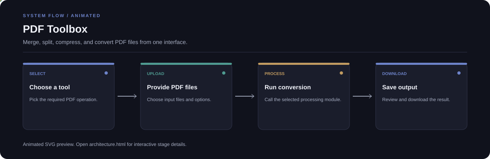

# PDF Toolbox

**Merge, split, compress, and convert PDF files from one interface.**

[](https://github.com/chyk2468/My_love_pdf)

## 1. Project Title & Tagline

Merge, split, compress, and convert PDF files from one interface.

## 2. Problem Statement

Common PDF tasks often require separate tools. This project groups multiple PDF operations behind a Streamlit interface so users can select a task and download the processed file.

## 3. Project Preview

Add a real screenshot or short GIF showing the input, main controls, and resulting output.

[Open interactive architecture](architecture.html)

## 4. Overview

The application follows a clear input-to-output workflow. The exact model or processing behaviour depends on the current code and configuration in the repository.

## 5. Key Features

- Merge multiple PDF files.
- Split selected page ranges.
- Compress PDFs.
- Convert supported PDF content to Excel or Word.

## 6. Architecture / Workflow



Open the [interactive architecture explorer](architecture.html) to select a stage and inspect its role.

## 7. Tech Stack

Python, Streamlit, PyMuPDF, and the PDF conversion libraries listed in requirements.txt

## 8. Installation & Setup

```bash
git clone https://github.com/chyk2468/My_love_pdf.git
cd My_love_pdf
python -m venv .venv
pip install -r requirements.txt
```

## 9. Usage

Run `streamlit run app.py`, select an operation, upload the required PDF files, set the options, and download the result. Check converted documents for missing text, layout shifts, or table errors.

## 10. Project Structure

- `app.py`: application routing
- `ui.py`: shared interface
- `merge.py`: PDF merging
- `splitpdf.py`: page-range splitting
- `compresspdf.py`: compression
- `pdf2excel.py`: Excel conversion
- `pdf2word.py`: Word conversion

## 11. Results & Demo

Use representative text PDFs, scanned documents, and tables to test each operation. Add screenshots and a small before/after file-size table after running the current version.

## 12. Future Enhancements

- Add batch processing and progress feedback.
- Improve OCR language and layout options.
- Add file-size and page-count summaries.
- Expand tests for corrupted or encrypted PDFs.

## 13. License

Check the repository and third-party library licences before redistributing the application.
