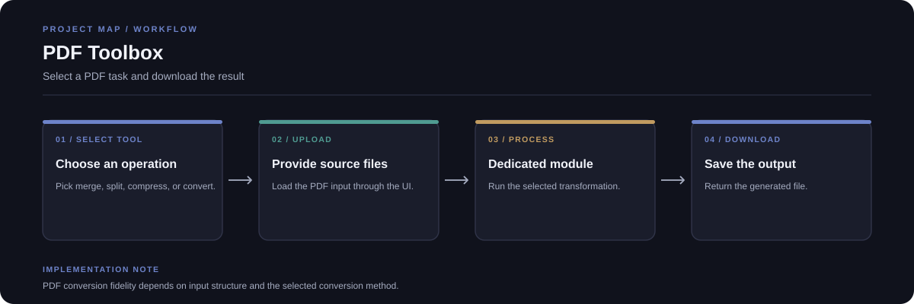

# PDF Toolbox

A Streamlit application that groups common PDF operations behind one interface: merge, split, compress, PDF-to-Excel, and PDF-to-Word.

**Stack:** Python, Streamlit, PyMuPDF, PDF processing and conversion libraries



## Available tools

- Merge multiple PDF files into one.
- Split selected page ranges into separate files.
- Compress PDF files.
- Convert supported PDF content to Excel.
- Convert supported PDF content to Word, with an OCR option where configured.

## Workflow

1. Select a tool in the Streamlit interface.
2. Upload the required PDF file or files and choose options.
3. The app calls the matching module.
4. Download the generated result from the interface.

## Run locally

```bash
git clone https://github.com/chyk2468/My_love_pdf.git
cd My_love_pdf
python -m venv .venv
```

Activate the environment and install dependencies:

```bash
pip install -r requirements.txt
streamlit run app.py
```

## Project layout

- `app.py`: routes selected UI actions
- `ui.py`: shared Streamlit interface
- `merge.py`: merge PDFs
- `splitpdf.py`: split page ranges
- `compresspdf.py`: compression
- `pdf2excel.py`: PDF-to-Excel conversion
- `pdf2word.py`: PDF-to-Word conversion

## Notes

Check the converted document before using it. Scanned PDFs, complex tables, embedded fonts, and unusual page layouts can affect the output quality. Avoid uploading sensitive documents to shared or untrusted environments.
